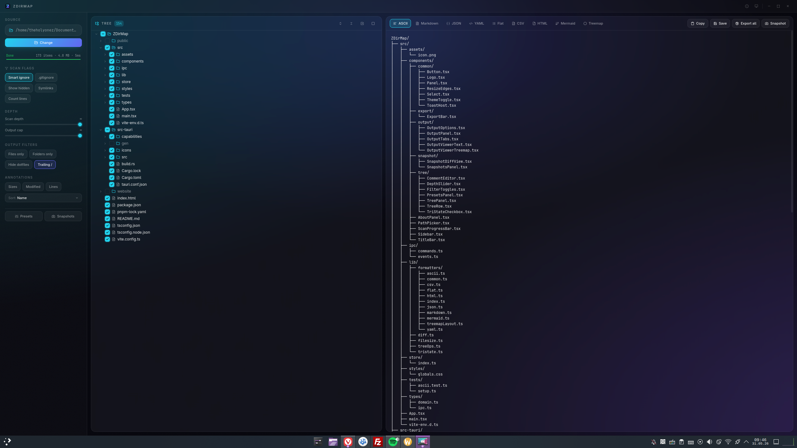

<div align="center">


<h1>ZDirMap</h1>

<p><strong>The go-to directory tree tool.</strong><br/>
Map any folder. Navigate, filter, annotate, and export it in 9 formats — from ASCII trees for your README, to interactive HTML, to a WinDirStat-style treemap.</p>

<p>
  <a href="https://zsync.eu/zdirmap/"></a>
  <a href="https://github.com/TheHolyOneZ/ZDirMap/releases"></a>
  <a href="https://www.gnu.org/licenses/gpl-3.0.html"></a>
</p>

<p>
  <sub>Built with Tauri 2 · React 19 · Rust · TypeScript</sub>
</p>

</div>

---

> [!NOTE]
> **Prebuilt installers** for Windows, macOS, and Linux live at **[zsync.eu/zdirmap](https://zsync.eu/zdirmap/)**.
> You can also grab the latest artifacts from the [GitHub Releases](https://github.com/TheHolyOneZ/ZDirMap/releases) page.
> No need to build from source unless you want to hack on it.

> [!TIP]
> Built because the alternatives are either ancient, web-only, or locked behind subscriptions. ZDirMap is free, native, fast, and ships as a tiny binary thanks to Tauri.

---

## 📸 Preview

<div align="center">
  
  <sub>Frameless glass shell · virtualized tree · live output in 9 formats</sub>
</div>

---

## ✨ What it does

- 🌳 **Streaming scan** with live progress + cancellation — handles huge directories without freezing
- ☑️ **Tri-state checkboxes** with O(depth) propagation — pick exactly what ends up in the output
- 📦 **9 output formats** — ASCII, Markdown, JSON, YAML, Flat path list, CSV, HTML, Mermaid, and a WinDirStat-style **treemap**
- 🗺️ **Squarified treemap** with drill-in navigation
- 📸 **Snapshots + diff** between scans to spot what changed
- 🚫 **Saved ignore presets** + automatic `.gitignore` import + glob patterns
- ✋ **Drag-and-drop reorder** — grab any tree row by its grip handle and rearrange siblings; the new order flows straight into every output format
- 💬 **Inline `# comments`** on any row, virtualized tree (rendering 100k+ rows is fine)
- 📑 **One-click export-all** writes every format to a directory at once
- 📊 **Annotations** — file sizes, modified times, and **line counts** in the output

---

## 📥 Download

> [!IMPORTANT]
> Pick your platform on the website — it serves the right binary for you.
>
> 👉 **[zsync.eu/zdirmap](https://zsync.eu/zdirmap/)**

| Platform | Format |
|----------|--------|
| Windows  | `.msi` installer + portable `.exe` |
| macOS    | `.dmg` (Apple Silicon + Intel) |
| Linux    | `.AppImage`, `.deb`, `.rpm` |

---

## 🛠️ Build from source

```bash
git clone https://github.com/TheHolyOneZ/ZDirMap.git
cd ZDirMap
pnpm install
pnpm tauri dev      # run dev
pnpm tauri build    # bundle installers
```

You need:
- **Node** 20+ and **pnpm** 9+
- **Rust** stable toolchain
- Platform deps for Tauri 2 — see the [Tauri prerequisites](https://v2.tauri.app/start/prerequisites/)

---

## 🧱 Tech stack

| Layer | Tools |
|-------|-------|
| Shell | Tauri 2 (Rust) |
| Frontend | React 19 · TypeScript · Vite 7 |
| Styling | Tailwind 4 with custom theme tokens |
| State | Zustand 5 (composed slices) |
| Tree | `@tanstack/react-virtual` |
| Treemap | `d3-hierarchy` (squarified) |
| Motion | `motion` (Framer) |
| Scan | `walkdir` · `globset` · `ignore` · `tokio` |

---

## 🔗 Links

- 🌐 Website — [zsync.eu](https://zsync.eu)
- 📦 ZDirMap — [zsync.eu/zdirmap](https://zsync.eu/zdirmap/)
- 🐙 GitHub — [github.com/TheHolyOneZ](https://github.com/TheHolyOneZ)
- 🧰 Source — [github.com/TheHolyOneZ/ZDirMap](https://github.com/TheHolyOneZ/ZDirMap)

---

## 📜 License

ZDirMap © 2026 **TheHolyOneZ** — Released under the [GNU General Public License v3.0](https://www.gnu.org/licenses/gpl-3.0.html).

<div align="center">
<sub>Built with care. If ZDirMap saved you time, a ⭐ on GitHub goes a long way.</sub>
</div>
