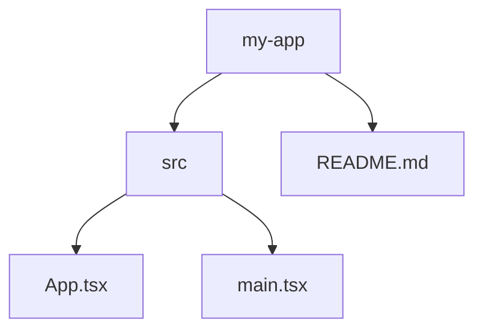

<div align="center">


<h1>ZDirMap</h1>

<p><strong>The go-to directory tree tool.</strong><br/>
Map any folder. Navigate, filter, annotate, and export it in 9 formats — from ASCII trees for your README, to interactive HTML, to a WinDirStat-style treemap.</p>

<p>
  <a href="https://zsync.eu/zdirmap/"></a>
  <a href="https://www.gnu.org/licenses/gpl-3.0.html"></a>
</p>

<p>
  <sub>Built with Tauri 2 · React 19 · Rust · TypeScript</sub>
</p>

</div>

---

> [!NOTE]
> **Prebuilt installers** for Windows, macOS, and Linux live at **[zsync.eu/zdirmap](https://zsync.eu/zdirmap/)**.
> You can also grab the latest artifacts from the [GitHub Releases](https://github.com/TheHolyOneZ/ZDirMap/releases) page.
> No need to build from source unless you want to hack on it.

> [!TIP]
> Built because the alternatives are either ancient, web-only, or locked behind subscriptions. ZDirMap is free, native, fast, and ships as a tiny binary thanks to Tauri.

---

## 📸 Preview

<div align="center">
  
  <sub>Frameless glass shell · virtualized tree · live output in 9 formats</sub>
</div>

---

## ✨ What it does

- 🌳 **Streaming scan** with live progress + cancellation — handles huge directories without freezing
- ☑️ **Tri-state checkboxes** with O(depth) propagation — pick exactly what ends up in the output
- 📦 **9 output formats** — ASCII, Markdown, JSON, YAML, Flat path list, CSV, HTML, Mermaid, and a WinDirStat-style **treemap**
- 🗺️ **Squarified treemap** with drill-in navigation
- 📸 **Snapshots + diff** between scans to spot what changed
- 🚫 **Saved ignore presets** + automatic `.gitignore` import + glob patterns
- ✋ **Drag-and-drop reorder** — grab any tree row by its grip handle and rearrange siblings; the new order flows straight into every output format
- 💬 **Inline `# comments`** on any row, virtualized tree (rendering 100k+ rows is fine)
- 📑 **One-click export-all** writes every format to a directory at once
- 📊 **Annotations** — file sizes, modified times, and **line counts** in the output

---

## 🧭 Output formats

Nine ways to look at the same tree. The active tab updates live as you check, uncheck, reorder, or annotate rows.

### 🌳 ASCII tree
The classic. Box-drawing characters, depth-aware indentation, optional annotations, inline comments.
```
my-app/ (14.2 MB, 8,412 lines)
├── src/ (2.1 MB, 5,118 lines)
│   ├── App.tsx (2.4 KB, 84 lines)  # entry
│   ├── main.tsx (0.6 KB, 22 lines)
│   └── store.ts (4.8 KB, 212 lines)
├── README.md (3.1 KB, 98 lines)
└── package.json (1.2 KB, 48 lines)
```

### 📝 Markdown
GitHub-flavored nested bullet list — drop straight into a README.
```markdown
- my-app/
  - src/
    - App.tsx
    - main.tsx
    - store.ts
  - README.md
  - package.json
```

### 🔧 JSON
Nested, machine-readable. Includes `name`, `isDir`, and any active annotations.
```json
{
  "name": "my-app",
  "isDir": true,
  "size": 14894694,
  "lines": 8412,
  "children": [
    { "name": "App.tsx", "isDir": false, "size": 2458, "lines": 84, "comment": "entry" }
  ]
}
```

### 📄 YAML
Same shape as JSON, more human-friendly for config-style use.
```yaml
- name: my-app
  type: dir
  size: 14894694
  lines: 8412
  children:
    - name: App.tsx
      type: file
      size: 2458
      lines: 84
      comment: entry
```

### 📋 Flat path list
Every selected path, one per line, relative to the root. Pipe-into-anything friendly.
```
my-app/
my-app/src/
my-app/src/App.tsx
my-app/src/main.tsx
my-app/README.md
```

### 📊 CSV
Spreadsheet-ready. Columns toggle on with the annotations.
```csv
path,type,depth,size,lines,comment
my-app/,dir,0,14894694,8412,
my-app/src/App.tsx,file,2,2458,84,entry
```

### 🌐 HTML
Self-contained, styled, collapsible HTML page. Open it in a browser, share it, host it.

### 🧜 Mermaid diagram
Drop the output into any Mermaid-aware Markdown renderer (GitHub, GitLab, Notion, Obsidian) and get a rendered tree diagram.


### 🟦 Treemap (WinDirStat-style)
A squarified, color-graded SVG treemap that visualizes disk usage at a glance. Click a rectangle to drill in; breadcrumbs let you walk back out. The fastest way to find what's eating your disk.

---

## ⚙️ Scan flags

Flags in the sidebar that change *what gets walked* on disk. Tweak them, then re-scan.

| Flag | What it does |
|------|--------------|
| **Smart ignore** | Skip the usual noise — `node_modules`, `.git`, `target`, `dist`, `build`, etc. On by default. |
| **.gitignore** | Auto-import the patterns from the scanned root's `.gitignore` and respect them. |
| **Show hidden** | Include dotfiles and dot-directories (`.env`, `.vscode/`, …). Off by default. |
| **Symlinks** | Follow symbolic links instead of skipping them. Cycle-safe. |
| **Count lines** | Read each text file (≤ 8 MB, binary-detected) and count newlines. Aggregates to parent dirs. |
| **Scan depth** | Stop the walker at depth N (or ∞). Useful for huge trees you don't fully care about. |

---

## 🎛️ Output options

Don't trigger a re-scan — these reshape the *output* from data already in memory. Updates are instant.

### Annotations
Toggle what shows next to each row in the output.

| Annotation | Example | Notes |
|------------|---------|-------|
| **Sizes** | `(14.2 MB)` | Human-readable; dirs show aggregated descendant size. |
| **Modified** | `(2d ago)` | Relative time since `mtime`. |
| **Lines** | `(212 lines)` | Only present when "Count lines" was enabled during scan. |

All three can be combined: `(14.2 MB, 2d ago, 8,412 lines)`.

### Output filters
Reshape the tree without losing the underlying selection.

| Filter | Effect |
|--------|--------|
| **Files only** | Hide intermediate folders from the output (paths still traverse them). |
| **Folders only** | Drop files entirely; great for directory-structure docs. |
| **Hide dotfiles** | Strip rows whose name starts with `.` from the output. |
| **Trailing /** | Append `/` to directory names (off by default for some formats). |
| **Output cap** | Cap output at depth N independent of scan depth — preview a deep tree without re-scanning. |
| **Sort** | Name (A→Z), Size (large→small), or Modified (recent→old). |

---

## ✋ Drag-and-drop reorder

Hover any tree row, a grip handle fades in on the right. Grab it and drag to reorder siblings under the same parent. The new order is stored as a per-parent override and applied to every output format — ASCII branches redraw, JSON children reshuffle, CSV rows resequence, all instantly.

Order resets when you re-scan unless you save it to a **snapshot**.

---

## 💬 Inline comments

Click the comment bubble that appears on a row hover to attach a free-text comment. It renders as `# comment` in ASCII / Markdown / Flat, as a `comment:` field in JSON / YAML / CSV, and as edge labels in Mermaid.

---

## 📸 Snapshots & diff

A snapshot is a single `.zdirmap` JSON file capturing the full scan state at a moment in time: the tree, your selection, comments, custom order, output options, scan options.

| Use case | How |
|----------|-----|
| **Save a scan** | Click the camera button → file is written to the app config dir. |
| **Reopen** | Snapshots panel lists everything you saved. |
| **Diff** | Compare two snapshots — see what was added, removed, or changed size. |
| **Share** | The file is plain JSON, version-controlled, diff-able in git. |

---

## 🚫 Ignore presets

Save a set of glob patterns as a named preset. Patterns match per-path-component (so `node_modules` catches `**/node_modules/**`). Auto-import a project's `.gitignore` to seed a preset in one click. Presets persist as JSON in the app config dir.

---

## ⌨️ Other niceties

- **Frameless glass shell** — custom titlebar with drag-region, native min / max / close.
- **Theme toggle** — dark / light / follow-system.
- **One-click export-all** — pick a directory and ZDirMap writes every format at once (`tree.ascii.txt`, `tree.markdown.md`, `tree.json`, …).
- **Copy** the current output to clipboard.
- **Toast notifications** for scan completion, errors, and exports.
- **Virtualized tree** — 100k+ rows scroll smoothly because only the visible window mounts.
- **Cancellable scans** — kick off a scan of `/`, change your mind, hit cancel, no orphaned work.

---

## 📥 Download

> [!IMPORTANT]
> Pick your platform on the website — it serves the right binary for you.
>
> 👉 **[zsync.eu/zdirmap](https://zsync.eu/zdirmap/)**

| Platform | Format |
|----------|--------|
| Windows  | `.msi` installer + portable `.exe` |
| macOS    | `.dmg` (Apple Silicon + Intel) |
| Linux    | `.AppImage`, `.deb`, `.rpm` |

---

## 🛠️ Build from source

```bash
git clone https://github.com/TheHolyOneZ/ZDirMap.git
cd ZDirMap
pnpm install
pnpm tauri dev      # run dev
pnpm tauri build    # bundle installers
```

You need:
- **Node** 20+ and **pnpm** 9+
- **Rust** stable toolchain
- Platform deps for Tauri 2 — see the [Tauri prerequisites](https://v2.tauri.app/start/prerequisites/)

---

## 🧱 Tech stack

| Layer | Tools |
|-------|-------|
| Shell | Tauri 2 (Rust) |
| Frontend | React 19 · TypeScript · Vite 7 |
| Styling | Tailwind 4 with custom theme tokens |
| State | Zustand 5 (composed slices) |
| Tree | `@tanstack/react-virtual` |
| Treemap | `d3-hierarchy` (squarified) |
| Motion | `motion` (Framer) |
| Scan | `walkdir` · `globset` · `ignore` · `tokio` |

---

## 🔗 Links

- 🌐 Website — [zsync.eu](https://zsync.eu)
- 📦 ZDirMap — [zsync.eu/zdirmap](https://zsync.eu/zdirmap/)
- 🐙 GitHub — [github.com/TheHolyOneZ](https://github.com/TheHolyOneZ)
- 🧰 Source — [github.com/TheHolyOneZ/ZDirMap](https://github.com/TheHolyOneZ/ZDirMap)

---

## 📜 License

ZDirMap © 2026 **TheHolyOneZ** — Released under the [GNU General Public License v3.0](https://www.gnu.org/licenses/gpl-3.0.html).

<div align="center">
<sub>Built with care. If ZDirMap saved you time, a ⭐ on GitHub goes a long way.</sub>
</div>
